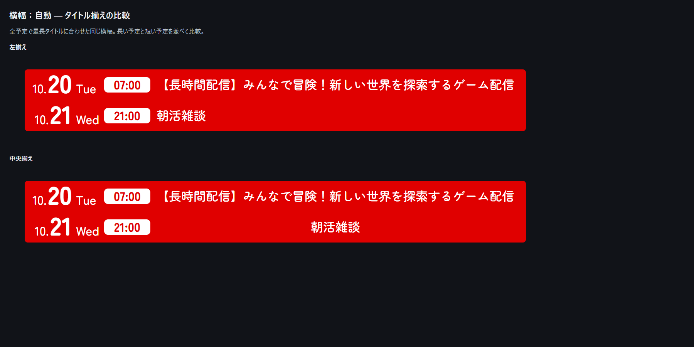

# 表示と翌日の予定

- 予定タブの「今日」の右にある矢印で翌日へ進むか、表示日数を増やすと、新しく表示範囲に加わる日へ7日前の時刻・内容をすべてコピーします。入力済みの予定、または一度消した予定は上書きしません。先週に予定がない場合は空欄です。
- 設定の「横幅：自動」を有効にすると、表示範囲内の最長タイトルに合わせて全予定の共通幅を決定します。タイトルが切り替わっても幅は変わりません。横・縦の両テーマに対応し、背景も同じ幅になります。手動の背景横幅は自動を解除すると再び使用できます。
- 「タイトル揃え」で左揃え・中央揃えを選択できます。初期値は左揃えです。

比較画像は実際の表示から作成し、長い予定と短い予定を同時に並べています。

横表示の確定値：月と日の間隔3px、日から曜日10px、タイトル右余白30px、初期値は左揃え。日付・曜日の欄は文字幅を実測して詰め、1桁の日も曜日への間隔を保ちます。時刻の縦位置・太さ・上下余白は従来の表示を維持しています。

## 保存期間

予定はブラウザのlocalStorageに保存します。「今日」を基準に14日前までの予定と、未来の予定を保持します。それより古い予定・空欄の日付の記録は、control.htmlを開いたとき、保存したとき、画面にフォーカスが戻ったときに自動削除します。

例：10月14日は9月30日以降を保持し、9月29日以前を削除します。例外として、現在表示中の日付と、その7日前からのコピー元の範囲は保護します。未来の入力済み予定は削除しません。削除済みの古い予定は、過去へ戻しても復元されません。
